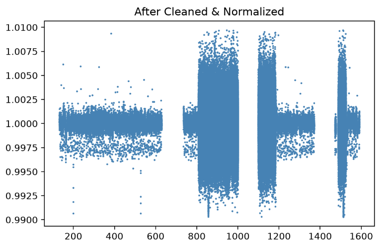
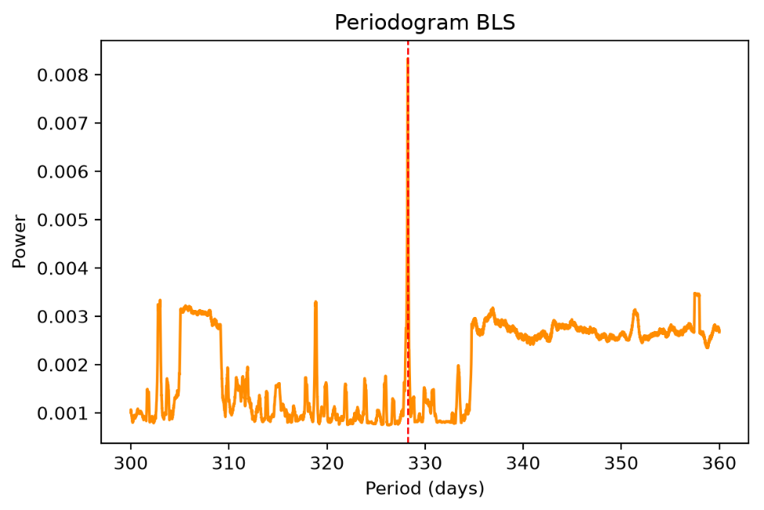
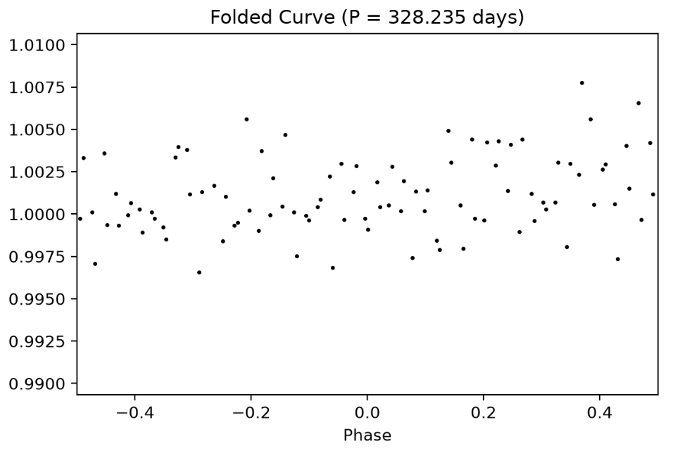
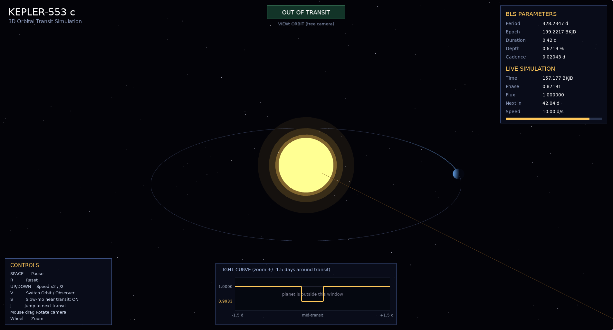

# Kepler-553 c Light Curve Analysis


Detection and visualization of the long-period transit signal of **Kepler-553 c** from real **NASA Kepler** photometry, using Box-fitting Least Squares (BLS) in Python and an interactive 3D transit simulation in C++ (SFML + OpenGL).

---

## Table of Contents

1. [Overview](#overview)
2. [Target System](#target-system)
3. [Project Structure](#project-structure)
4. [Installation](#installation)
5. [Usage](#usage)
6. [Objectives](#objectives)
7. [Data](#data)
8. [Data Processing](#data-processing)
9. [Results](#results)
10. [Output Files and Examples](#output-files-and-examples)
11. [C++ Transit Simulation](#c-transit-simulation)
12. [Limitations](#limitations)
13. [Troubleshooting](#troubleshooting)
14. [References](#references)

---

## Overview

This project analyzes real photometric observations of the **Kepler-553 exoplanet system**. The main objective is to process multi-quarter Kepler observations, identify periodic transit signals, estimate the orbital period and transit epoch, construct a phase-folded light curve, and investigate the transit signal associated with **Kepler-553 c**.

The analysis uses the **Box-fitting Least Squares (BLS)** method to search for periodic transit signals. The derived parameters are then used as input for a C++ simulation that visualizes the transit.

---

## Target System

**Target:** Kepler-553 c
**KIC:** 10937029

The Kepler-553 system contains at least two confirmed planets:

| Planet       | Period (days) | Transit Depth | Transit Duration |
| ------------ | ------------: | ------------: | ---------------: |
| Kepler-553 b |         4.030 |        ~0.30% |      ~2.80 hours |
| Kepler-553 c |       328.240 |        ~0.29% |     ~12.27 hours |

> **Check before publishing:** the previous version of this table listed ~1.43% depth and ~12.13 hours for Kepler-553 c, which disagrees with the published values used in the [Results](#results) table (0.290830% and 0.51135833 days = 12.27 hours). Verify against the NASA Exoplanet Archive and keep both tables consistent.

The main focus is **Kepler-553 c**. Its orbital period is much longer than that of Kepler-553 b, so only a few transits fall inside the Kepler baseline, which makes the signal harder to detect.

---

## Project Structure

```text
.         
├── data/
│   ├── metadata/
│   └── raw/
├── images/                    
├── output/                  
│   ├── comparison parameter.csv
│   ├── light curve analysis.png
│   └── result of analysis.txt
├── simulation/
│   ├── kepler             
│   ├── main2D.cpp
│   └── mian3D.cpp
├── install.sh                  
├── main.py               
├── README.md
└── requirements.txt
```

---

## Installation

### Requirements

1. Python 3
2. The Python packages listed in `requirements.txt`
3. The Kepler data files (see [Data](#data))
4. A C++17 compiler, SFML 3, OpenGL and GLU (for the simulation)

### Python

```bash
pip install -r requirements.txt
```

```bash
bash install.sh
```

Using a virtual environment is recommended:

```bash
python3 -m venv .venv
source .venv/bin/activate
pip install -r requirements.txt
```

### C++ simulation (Arch Linux)

```bash
sudo pacman -S sfml glu ttf-dejavu pkgconf
```

On other distributions, install the equivalent SFML 3, GLU and DejaVu font packages. SFML 3 is required (the code uses the SFML 3 API).

---

## Usage

### 1. Run the analysis

```bash
python3 main.py
```

All results are written to `output/`.

### 2. Build and run the simulation

```bash
cd simulation
g++ -std=c++17 main.cpp -o kepler \
    $(pkg-config --cflags --libs sfml-graphics sfml-window sfml-system gl glu)
./kepler
```

---

## Objectives

* Download and process photometric observations of the Kepler-553 system.
* Combine observations from multiple Kepler quarters.
* Inspect and organize the observational data.
* Remove missing (`NaN`) values.
* Remove statistical outliers.
* Normalize the observed flux.
* Detrend the stellar light curve.
* Search for periodic transit signals using the **Box-fitting Least Squares (BLS)** method.
* Estimate the orbital period of the detected signal.
* Determine the transit epoch (`t0`).
* Estimate the transit duration and transit depth.
* Fold the light curve according to the estimated orbital period.
* Investigate the transit signal associated with Kepler-553 c.
* Compare the derived parameters with published values.
* Use the derived parameters as input for a computational simulation.

---

## Data

The observational data come from the **NASA Kepler Mission** and can be obtained from the **NASA Exoplanet Archive** and the relevant Kepler data archives (MAST).

### Parameters

* **Orbital Period (`P`)**
* **Transit Epoch (`t0`)**
* **Transit Duration**
* **Transit Depth**
* **BLS Power**

Times are in **BKJD** (Barycentric Kepler Julian Date, BJD − 2454833).

---

## Data Processing

```text
Multiple Kepler Quarter Files
            ↓
      Combine Data
            ↓
       Sort by Time
            ↓
       Data Inspection
            ↓
        Remove NaN
            ↓
      Remove Outliers
            ↓
      Normalize Flux
            ↓
         Detrending
            ↓
   Processed Light Curve
            ↓
       BLS Analysis
            ↓
      Transit Detection
            ↓
      Phase Folding
```

### Transit Search

The transit times are represented by:

$$
t_n = t_0 + nP
$$

where $t_n$ is the time of the $n$-th transit, $t_0$ is the reference transit epoch, $P$ is the orbital period, and $n$ is an integer transit number.

The phase-folded light curve is calculated using:

$$
\phi = \left( \frac{t - t_0}{P} \right) \bmod 1
$$

where $\phi$ is the orbital phase and $t$ is the observation time.

### Parameter Comparison

The absolute difference between an analysis value and a published value is:

$$
\Delta X = X_{\mathrm{analysis}} - X_{\mathrm{published}}
$$

The relative percentage difference is:

$$
\Delta X = \frac{|X_{\text{analysis}} - X_{\text{published}}|}{|X_{\text{published}}|} \times 100\%
$$

---

## Results of Kepler-553 c

| Parameter            |   Derived Value |    Published Uncertainty | Published Value |  Difference |
| -------------------- | --------------: | -----------------------: | --------------: | ----------: |
| Orbital Period (`P`) | 328.234706 days | +0.00039 / −0.00040 days | 328.240170 days |   0.001665% |
| Transit Epoch (`t0`) | 199.221670 BKJD |            0.000858 days | 199.203375 BKJD |   0.009184% |
| Transit Duration     |       0.42 days |       0.00279583333 days | 0.51135833 days |  17.865815% |
| Transit Depth        |     0.67194886% |                 0.00148% |       0.290830% | 131.045236% |

### Interpretation

The derived orbital period is very close to the published value (about **0.001665%** relative difference), and the transit epoch also agrees well (about **0.009184%**).

The derived transit duration and depth differ substantially from the published values. Possible contributors include the simple box model used by BLS, the detrending procedure, the sparse sampling of a long-period transit, and the treatment of the light curve. The derived parameters should therefore be read as **results of this computational analysis**, not as replacements for the published planetary parameters.

---

## Output Files and Examples

After running `python3 main.py`, the following files are written to `output/`.

| File                           | Description                                                                                  |
| ------------------------------ | -------------------------------------------------------------------------------------------- |
| `comparison parameter.csv`     | Compare analytic data with real or published data                                            |
| `light curve analysis.png`     | Raw light curve, Processed light curve, Periodogram BLS, Folded Curve                        |
| `result of analysis.txt`       | The result of the data after processed.                                                      |

## Plots

### Processed light curve

```markdown
*Figure 1. Processed light curve*
```

### BLS periodogram

```markdown
*Figure 2. BLS periodogram. The highest peak is at P = 328.2347 days.*
```

### Phase-folded light curve

```markdown
*Figure 3. Phase-Folded light curve*
```

---

## C++ Transit Simulation

The simulation (`simulation/main.cpp`) renders the star, the planetary orbit, the planet position, the transit event, the simulated light curve and the derived BLS parameters. It is a **visualization** of the derived transit model and does not replace the observational analysis.

### Parameters used

```text
Orbital Period     : 328.234706 days
Transit Epoch      : 199.221670 BKJD
Transit Duration   : 0.42 days
Transit Depth      : 0.67194886%
Cadence            : 0.0204339 days
```

These are defined at the top of `main.cpp`:

```cpp
constexpr double PERIOD_DAYS   = 328.234706;
constexpr double EPOCH_BKJD    = 199.22167045006876;
constexpr double DURATION_DAYS = 0.42;
constexpr double DEPTH_PERCENT = 0.6719488595745792;
constexpr double CADENCE_DAYS  = 0.0204339;
```

> If your source still uses `328.23470`, update it to `328.234706` so the simulation matches the analysis exactly.

### Controls

| Key / Input  | Action                                      |
| ------------ | ------------------------------------------- |
| `SPACE`      | Play / pause                                |
| `R`          | Reset to half a period before the transit   |
| `UP` / `DOWN`| Double / halve the simulation speed (days/s)|
| `V`          | Switch between orbit and observer view      |
| `S`          | Toggle automatic slow motion near transit   |
| `J`          | Jump to 2.5 days before the next transit    |
| Mouse drag   | Rotate the camera (orbit view)              |
| Mouse wheel  | Zoom                                        |
| `ESC`        | Quit                                        |

### Example: adding a screenshot

Run the simulation, press `J` to jump close to a transit, switch to observer view with `V`, take a screenshot and save it as `docs/images/simulation.png`:



```markdown
*Figure 4. Inside of the simulation*
```

### Note on scale

The sizes of the star, planet and orbit in the 3D view are chosen for readability and are **not to scale**. As a result, the planet visually overlaps the star for far longer than the 0.42-day transit shown in the light curve. The flux curve and transit timing follow the derived parameters; the 3D geometry is illustrative.

---

## Limitations

* The BLS box model does not account for limb darkening or ingress/egress shape.
* Only a few transits of a 328-day planet fall inside the Kepler baseline, so duration and depth are poorly constrained.
* Detrending can partially suppress or distort long-duration transits.
* The derived depth and duration differ significantly from published values (see [Results](#results)).

---

## Troubleshooting

| Problem | Likely cause and fix |
| ------- | -------------------- |
| Simulation window opens and closes immediately | Run `./kepler` in a terminal and read the message. A missing font is the most common cause: `sudo pacman -S ttf-dejavu`. |
| `Failed to open X11 display` | SFML 3 runs through XWayland. Check `echo $DISPLAY`. On niri, install `xwayland-satellite`. Hyprland provides XWayland by default. |
| Window fails to be created | In `main.cpp`, set `settings.antiAliasingLevel = 0;`. |
| `cannot find -lGLU` | Install GLU: `sudo pacman -S glu`. |
| Black screen with UI only | Make sure `renderScene(...)` is called every frame before `drawUI(...)`. |

---

## References

[^1] Agol, E., Luger, R. and Foreman-Mackey, D. (2020) 'Analytic Planetary Transit Light Curves and Derivatives for Stars with Polynomial Limb Darkening'. *The Astronomical Journal*. doi:10.3847/1538-3881/ab4fee.

[^2] Aigrain, S., Parviainen, H. and Pope, B. (2016) 'K2SC: Flexible systematics correction and detrending of K2 light curves using Gaussian Process regression'. *Monthly Notices of the Royal Astronomical Society*. doi:10.1093/mnras/stw706.

[^3] Aigrain, S. *et al.* (2016) 'Robust, open-source removal of systematics in Kepler data'. *Monthly Notices of the Royal Astronomical Society*, 000, pp. 1–12.

[^4] Berger, T. A. *et al.* (2020) 'The Gaia-Kepler Stellar Properties Catalog. I. Homogeneous Fundamental Properties for 186,301 Kepler Stars'. *The Astronomical Journal*, 159(6), 280. doi:10.3847/1538-3881/ab4fee.
